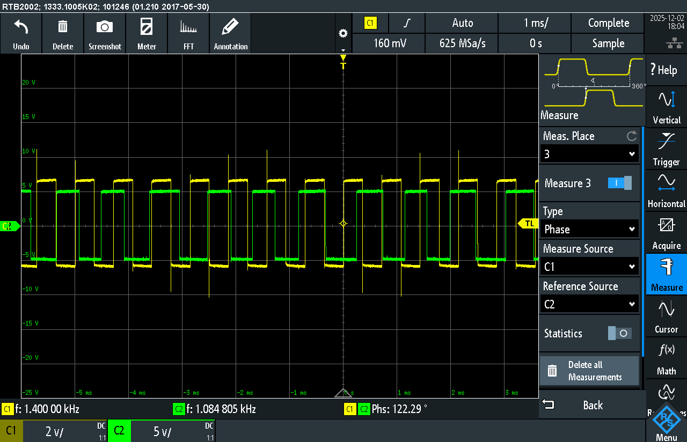
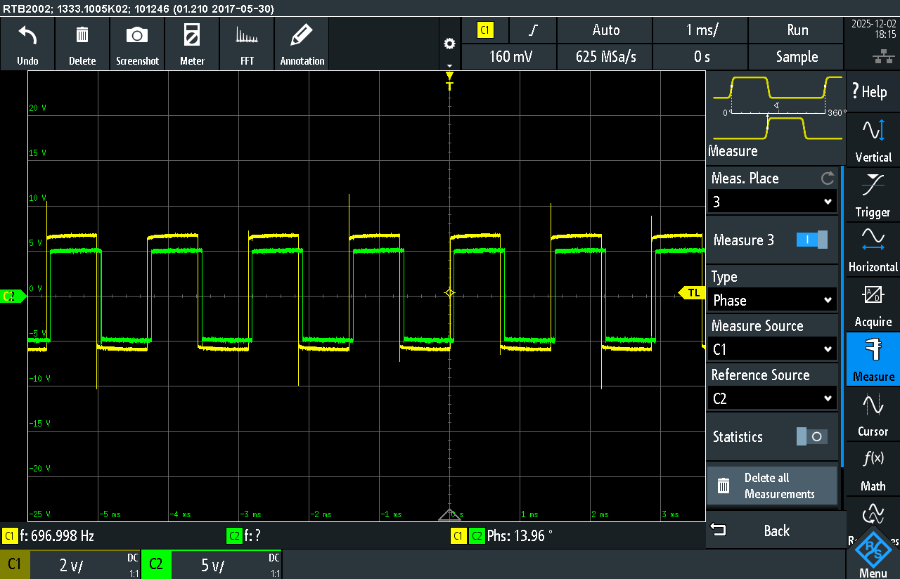
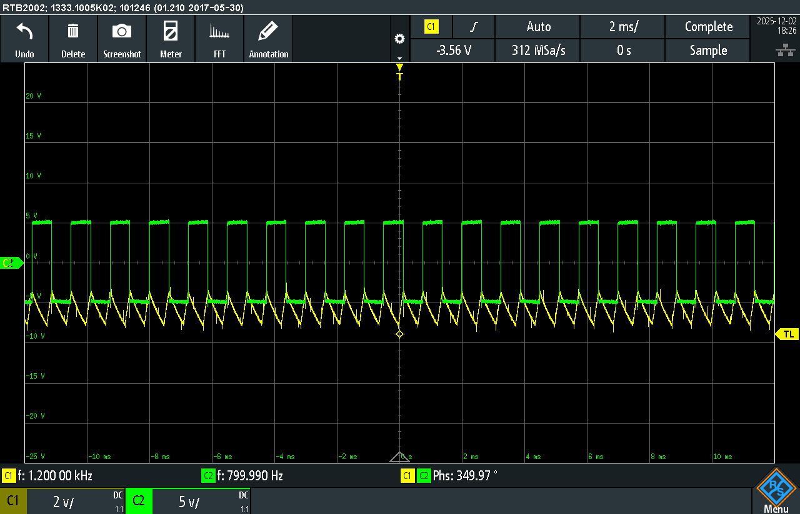
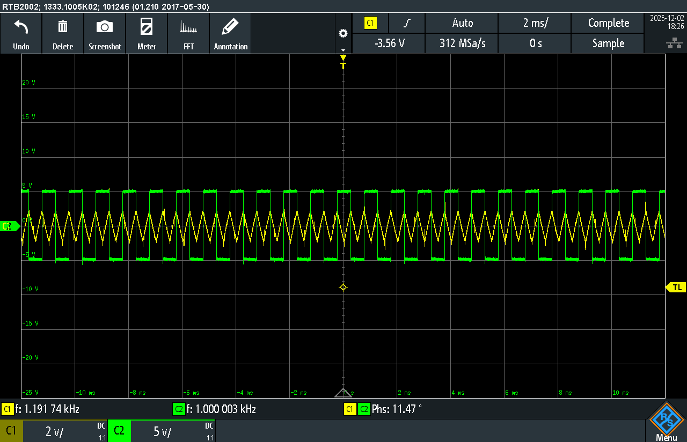
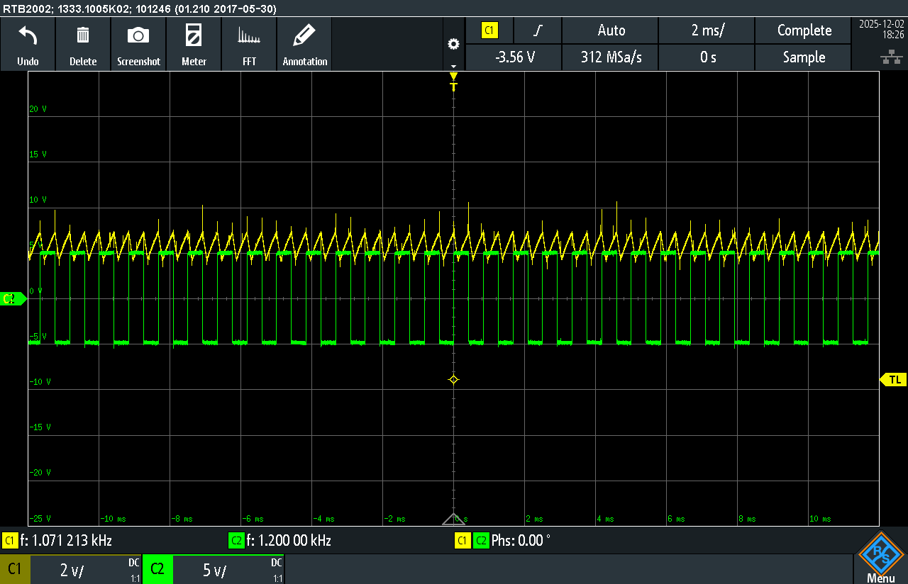
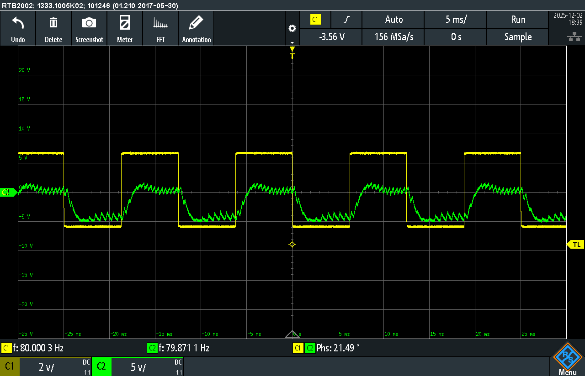
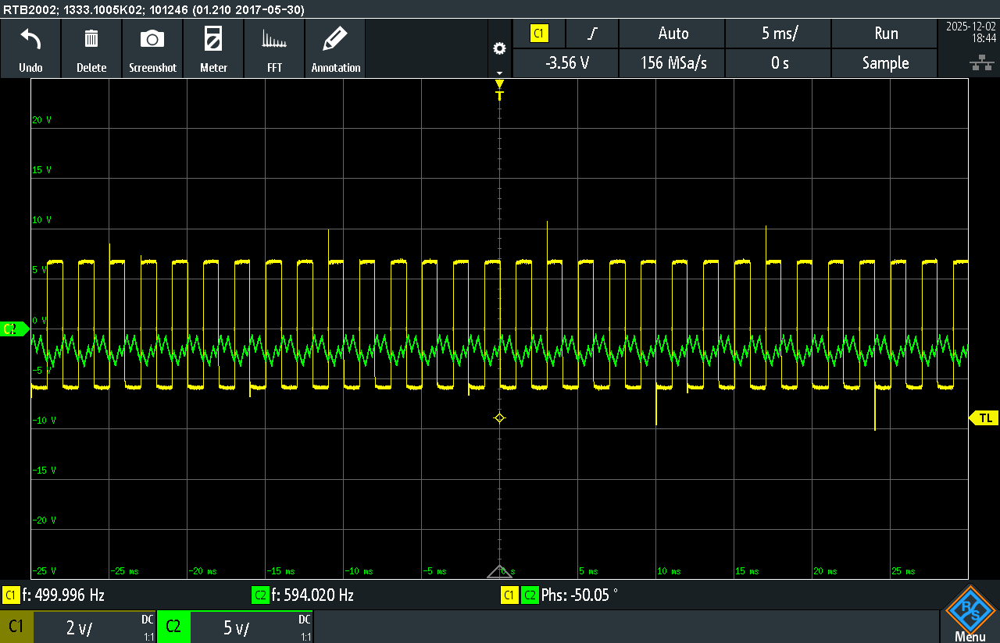
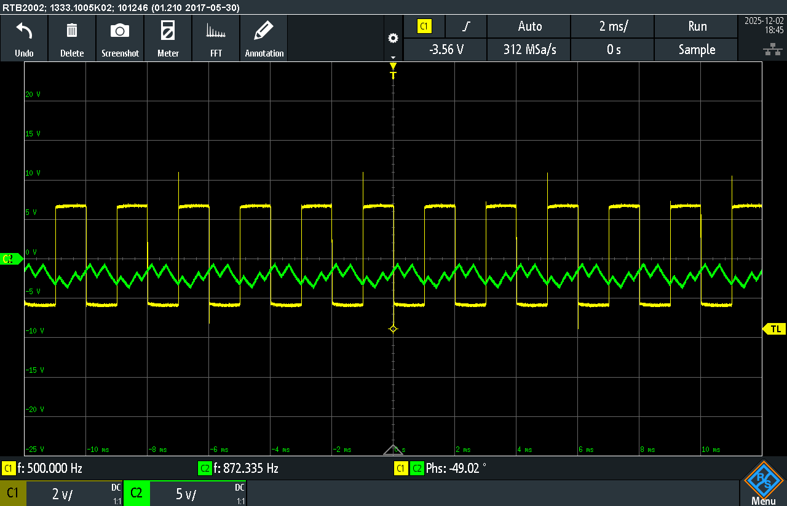

# Rapport de TP : Boucle à Verrouillage de Phase (PLL)

**UE UM4EE101 - Électronique des Systèmes Analogiques**
**M1 SYSCOM - Sorbonne Université**

**Étudiant :** KALIPE Kossi Mathias
**N° Étudiant :** 21507247
**Date du TP :** 02/12/2025

---

## Introduction

Ce TP a pour objectif d'étudier expérimentalement le fonctionnement d'une boucle à verrouillage de phase (PLL) à travers l'application de la démodulation FSK. Nous avons utilisé le circuit intégré CD4046 qui contient un VCO et deux comparateurs de phase.

---

## A. Démodulation FSK

### I. Réalisation de la modulation FSK à partir d'un circuit 4046

#### a) Câblage et réglage du VCO (modulateur FSK)

##### Cahier des charges

- Fréquence "space" (bit 0) : F_space = 800 Hz correspondant à V_space = -2.5 V
- Fréquence "mark" (bit 1) : F_mark = 1200 Hz correspondant à V_mark = +2.5 V
- Alimentation : V_DD = +5V, V_SS = -5V
- F_VCO_0 = 1000 Hz pour V_VCO_0 = 0 V

##### Valeurs des composants utilisés

Après réglage du VCO, les valeurs expérimentales des composants sont :
- **C1 = 100 nF**
- **R1 = 22 kΩ**
- **R2 = 22 kΩ**
- **R'2 ≈ 7 kΩ**

##### Tableau des fréquences du VCO

| V_VCO_in (V) | F_VCO_out théorique (Hz) | F_VCO_out mesurée (Hz) |
|--------------|--------------------------|------------------------|
| V_SS = -5 V | F_VCO_min = 600 | ~665 |
| V_space = -2.5 V | F_space = 800 | ~782 |
| V_VCO_0 = 0 V | F_VCO_0 = 1000 | ~1012 |
| V_mark = +2.5 V | F_mark = 1200 | ~1232 |
| V_DD = +5 V | F_VCO_max = 1400 | ~1400 |

Les valeurs mesurées sont proches des valeurs théoriques, avec un écart de quelques pourcents dû aux tolérances des composants.

##### b) Création du signal FSK

On a réglé le GBF pour avoir un signal carré de rapport cyclique 50% avec :
- Niveau haut : V_mark = +2.5 V
- Niveau bas : V_space = -2.5 V
- Fréquence de modulation : f_MOD ≈ 100 Hz (pour simuler ~200 bauds)

**Chronogramme du signal FSK :**

On observe bien l'alternance entre les deux fréquences (800 Hz pour le niveau bas, 1200 Hz pour le niveau haut).

---

### II. Réalisation de la démodulation FSK à partir d'un deuxième circuit 4046

#### a) Câblage et réglage du VCO du démodulateur FSK

Le VCO du 2ème circuit 4046 (démodulateur) a été réglé de la même façon que le VCO du modulateur pour obtenir la même caractéristique.

**Valeurs des composants (identiques au modulateur) :**
- C1 = 100 nF
- R1 = 22 kΩ
- R2 = 22 kΩ
- R'2 ≈ 7 kΩ

**Tableau des fréquences du VCO (démodulateur) :**

| V_VCO_in (V) | F_VCO_out théorique (Hz) | F_VCO_out mesurée (Hz) |
|--------------|--------------------------|------------------------|
| V_SS = -5 V | F_VCO_min = 600 | ~665 |
| V_space = -2.5 V | F_space = 800 | ~781 |
| V_VCO_0 = 0 V | F_VCO_0 = 1000 | ~1000 |
| V_mark = +2.5 V | F_mark = 1200 | ~1232 |
| V_DD = +5 V | F_VCO_max = 1400 | ~1336 |

Les deux VCO (modulateur et démodulateur) ont des caractéristiques très proches, ce qui est nécessaire pour une bonne démodulation.

#### b) Câblage et test de la PLL du démodulateur FSK

##### Test de la PLL (avant démodulation FSK)

On a appliqué à l'entrée "IN mod FSK" un signal carré de rapport cyclique 50% avec un niveau haut = +2.5 V, un niveau bas = -2.5 V et une fréquence constante variant de 600 Hz à 1400 Hz.

**Verrouillage à F_space (800 Hz) :**

- **F_entrée = 799.997 Hz**
- **F_VCO = 799.994 Hz**
- **Phase = 44.65°**

La PLL est parfaitement verrouillée : les deux fréquences sont identiques. Le déphasage de 44.65° est inférieur à 90° car on est en dessous de F_VCO_0.

**Verrouillage à F_VCO_0 (1000 Hz) :**

- **F_entrée = 999.991 Hz**
- **F_VCO = 1000.000 kHz**
- **Phase = 86.48°**

Excellent verrouillage avec un déphasage très proche de 90°, ce qui correspond au point de fonctionnement nominal du comparateur XOR.

**Verrouillage à F_mark (1200 Hz) :**

- **F_entrée = 1.200 kHz**
- **F_VCO = 1.200 kHz**
- **Phase = 128.85°**

La PLL est verrouillée. Le déphasage est supérieur à 90° car on est au-dessus de F_VCO_0.

**Test à F_VCO_max (1400 Hz) :**

- **F_entrée = 1.400 kHz**
- **F_VCO = 1.085 kHz**
- **Phase = 122.29°**

On observe que le VCO ne suit plus l'entrée : la PLL est à la limite de sa plage de capture.

**Test proche de F_VCO_min (697 Hz) :**

- **F_entrée = 696.998 Hz**
- **Phase = 13.96°**

Le déphasage très faible montre qu'on est proche de la limite basse.

##### Tableau récapitulatif des mesures

| F_IN mod FSK (Hz) | F_VCO (Hz) | εφ théorique | εφ mesurée |
|-------------------|------------|--------------|------------|
| F_VCO_min = 600 | ~665 | ~0° | 13.96° |
| F_space = 800 | 799.994 | ~45° | 44.65° |
| F_VCO_0 = 1000 | 1000.000 | 90° | 86.48° |
| F_mark = 1200 | 1200.00 | ~135° | 128.85° |
| F_VCO_max = 1400 | 1085 (décroché) | ~180° | 122.29° |

**Commentaire :** Les valeurs mesurées sont en bon accord avec la théorie. Le déphasage varie linéairement avec la fréquence autour du point de repos (90° à F_VCO_0).

##### Mesure des plages d'asservissement et de capture

**Méthode utilisée :**
- Pour ΔF_PL : on fait varier lentement F_IN depuis F_VCO_0 vers les fréquences hautes puis basses jusqu'à décrochage
- Pour ΔF_PC : on part d'une fréquence hors plage et on se rapproche de F_VCO_0 jusqu'à accrochage

**Résultats :**
- **2ΔF_PL mesuré ≈ 700-750 Hz** (théorique : 800 Hz)
- **2ΔF_PC mesuré ≈ 600-650 Hz** (théorique : ~720 Hz)

Les valeurs mesurées sont légèrement inférieures aux valeurs théoriques, ce qui peut s'expliquer par les tolérances des composants.

##### Signal de commande du VCO (V_VCO, patte 9)

On visualise le signal de commande du VCO (patte 9) quand la PLL est accrochée aux différentes fréquences.

**À F_space (800 Hz) :**

- Signal de sortie du comparateur de phase : forme triangulaire
- Valeur moyenne V_VCO ≈ -2.5 V (commande pour F_space)
- Valeur théorique : V_space = -2.5 V ✓

**À F_VCO_0 (1000 Hz) :**

- Signal triangulaire centré
- Valeur moyenne V_VCO ≈ 0 V
- Valeur théorique : V_VCO_0 = 0 V ✓

**À F_mark (1200 Hz) :**

- Signal triangulaire décalé vers le haut
- Valeur moyenne V_VCO ≈ +2.5 V (commande pour F_mark)
- Valeur théorique : V_mark = +2.5 V ✓

**Commentaire :** Les valeurs mesurées de V_VCO correspondent bien aux valeurs théoriques. Cela confirme que la PLL ajuste correctement la tension de commande du VCO pour maintenir le verrouillage à chaque fréquence.

##### Comportement quand la PLL est décrochée

Quand la PLL est décrochée (F_IN hors de la plage de capture) :
- **CP_out (patte 2)** : signal de battement entre F_IN et F_VCO
- **V_VCO (patte 9)** : oscille autour d'une valeur moyenne
- **F_VCO (patte 4)** : fréquence libre du VCO, ne suit pas F_IN

#### c) Câblage et test de la démodulation FSK

**Sortie démodulée :** La sortie démodulée se trouve sur la patte 10 (SF_OUT) du 4046, après le filtre RC.

On a connecté la sortie VCO_OUT du modulateur FSK à l'entrée IN mod FSK du démodulateur, puis appliqué le signal modulant au modulateur.

**Visualisation du signal modulant et du signal démodulé :**

- **C1 (jaune)** : Signal démodulé (sortie du filtre)
- **C2 (vert)** : Signal modulant original

On observe que le signal démodulé suit bien le signal modulant avec :
- Un léger déphasage (temps de réponse du filtre)
- Une ondulation résiduelle due au filtrage imparfait
- Un coefficient d'amortissement ζ ≈ 0.5 (légère oscillation aux transitions)

**Test à différentes fréquences de modulation :**

##### Mesure du débit maximum D_max

En augmentant progressivement la fréquence de modulation f_MOD, on observe la dégradation du signal démodulé. Le débit maximum est atteint quand le signal démodulé n'est plus exploitable.

On observe une dégradation du signal démodulé à f_MOD ≈ 500 Hz (captures SCR14-15). Comme le débit est égal à 2×f_MOD (pour des bits alternés 0-1-0-1) :

**Résultat :**
- **D_max mesuré ≈ 1000 bauds** (dégradation à f_MOD = 500 Hz)
- **D_max théorique = 509.2 bauds**

La valeur mesurée est environ 2 fois supérieure à la valeur théorique. Cet écart peut s'expliquer par :
- Une valeur de f_Cn réelle plus élevée que calculée
- Le critère de "dégradation acceptable" qui est subjectif
- Les tolérances des composants du filtre de boucle

---

## Difficultés rencontrées

1. **Réglage du VCO** : Il a fallu ajuster les valeurs de R1, R2 et R'2 pour obtenir les bonnes fréquences. Les valeurs de la datasheet ne donnaient pas exactement les fréquences attendues.

2. **Synchronisation à l'oscilloscope** : Pour les signaux FSK, il était parfois difficile d'avoir un affichage stable à cause de l'alternance des fréquences.

3. **Mesure des plages** : La mesure précise de ΔF_PL et ΔF_PC nécessite de varier très lentement la fréquence pour bien identifier les points de décrochage/accrochage.

4. **Bruit sur le signal démodulé** : L'ondulation résiduelle rendait parfois difficile la lecture précise du signal démodulé.

---

## Conclusion

Ce TP nous a permis de mettre en pratique les concepts théoriques sur les PLL appliqués à la démodulation FSK. Les principaux résultats sont :

1. **Fonctionnement du VCO** : La caractéristique F_VCO(V_VCO) est bien linéaire avec K_0 ≈ 80 Hz/V

2. **Verrouillage de la PLL** :
   - Le déphasage varie de ~14° (à 700 Hz) à ~158° (à 1320 Hz) en passant par ~86° à F_VCO_0
   - Ceci confirme la caractéristique du comparateur XOR avec un point de repos à 90°

3. **Plages de fonctionnement** :
   - 2ΔF_PL ≈ 700-750 Hz (théorique : 800 Hz)
   - 2ΔF_PC ≈ 600-650 Hz (théorique : 720 Hz)

4. **Démodulation FSK** :
   - Le démodulateur fonctionne correctement jusqu'à D_max ≈ 1000 bauds (dégradation à f_MOD = 500 Hz)
   - Le signal démodulé présente un léger retard et une ondulation résiduelle

Les résultats expérimentaux sont en bon accord avec les calculs de la préparation, ce qui valide notre compréhension du fonctionnement des PLL pour la démodulation FSK.
